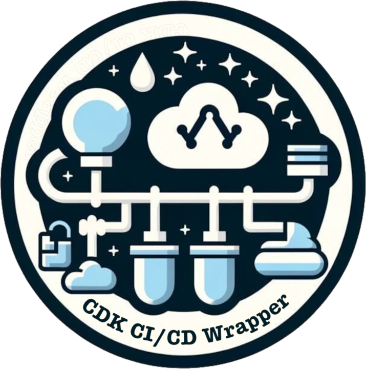
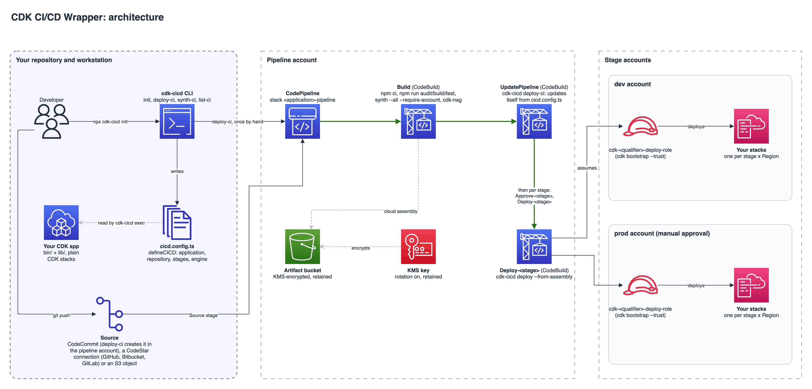

<p align="center">
  <a href="https://cdklabs.github.io/cdk-cicd-wrapper/">
    
    <h3 align="center">CDK CI/CD Wrapper</h3>
  </a>
</p>

<p align="center">
  <a href="https://cdklabs.github.io/cdk-cicd-wrapper/"><strong>Documentation</strong></a> ·
  <a href="https://github.com/cdklabs/cdk-cicd-wrapper/releases"><strong>Changelog</strong></a> ·
  <a href="#community"><strong>Join the community</strong></a>
</p>

<p align="center">
  <a href="https://opensource.org/licenses/Apache-2.0"></a>
  <a href="https://github.com/cdklabs/cdk-cicd-wrapper/actions/workflows/release.yml"></a>
  <a href="https://github.com/cdklabs/cdk-cicd-wrapper/commits/main"></a>
</p>

> [!WARNING]
> **Experimental — pre-release.** The developer experience documented below is the Autopilot (`1.x`)
> line, developed on `main`. Version `1.0.0` **is published to npm** but is **not** the `latest`
> dist-tag: `npm install` still resolves the stable `0.x` (Blueprint) line (currently `0.4.3`; **`0.4.0`
> is deprecated — do not use it**), whose API is _not_ the one described here. To install the `1.x` line
> explicitly, pin the version (`npm i @cdklabs/cdk-cicd-wrapper@1.0.0 @cdklabs/cdk-cicd-wrapper-cli@1.0.0`).
> For the `0.x` API see the
> [Blueprint (0.x) documentation](https://cdklabs.github.io/cdk-cicd-wrapper/legacy/), and the
> [Migration Guide](./MIGRATION.md) for the mapping between the two. `samples/cdk-cicd-wrapper-example/`
> is a complete `1.x` example. The public API is not frozen and may change.

# CDK CI/CD Wrapper

The CDK CI/CD Wrapper turns an ordinary AWS CDK app into a multi-account delivery pipeline. You describe the
source repository and the stages (each with its account and Regions) in one `cicd.config.ts`. The `cdk-cicd`
CLI provisions the pipeline in your pipeline account, and from then on every push builds, checks and deploys
the app stage by stage. Your `bin/` stays plain CDK: there is no wrapper code in it.

## How it works



1. **`npx cdk-cicd init`** writes `cicd.config.ts` and points `cdk.json` at `cdk-cicd exec`, which runs your
   app with the wrapper's hooks (tags, default security aspects, the stage's account and Region).
2. **`npx cdk-cicd deploy-ci`**, run once by hand, provisions the pipeline stack in the pipeline account.
3. **Every push** runs the pipeline: Source, Build (your checks, then a synth with cdk-nag), UpdatePipeline
   (the pipeline updates itself from `cicd.config.ts`), then one deploy per stage in order. Each deploy
   assumes the stage account's CDK bootstrap role, so the stage accounts must trust the pipeline account.

The diagram's draw.io source has three more pages: [what each engine renders](docs/content/assets/diagrams/autopilot-engine-shapes.png),
[container mode](docs/content/assets/diagrams/autopilot-container-mode.png) and
[the agent integrations](docs/content/assets/diagrams/autopilot-agent-integrations.png). The
[overview](https://cdklabs.github.io/cdk-cicd-wrapper/overview/index.html) walks through all four.

## Quick start

From a CDK app (for example a fresh `cdk init app --language typescript`):

```bash
npm i @cdklabs/cdk-cicd-wrapper@1.0.0 @cdklabs/cdk-cicd-wrapper-cli@1.0.0
npx cdk-cicd init --stages dev,prod   # writes cicd.config.ts, points cdk.json at cdk-cicd exec
```

`init` warns when your stack's `env` line is still commented out. Uncomment it, so every stack names its
account (`cdk-cicd exec` sets both variables for each stage):

```typescript
env: { account: process.env.CDK_DEFAULT_ACCOUNT, region: process.env.CDK_DEFAULT_REGION },
```

Bootstrap every account and Region a stage deploys to, trusting the pipeline account:

```bash
npx cdk bootstrap aws://STAGE_ACCOUNT/STAGE_REGION --trust PIPELINE_ACCOUNT \
  --cloudformation-execution-policies arn:aws:iam::aws:policy/AdministratorAccess
```

Then, with credentials for the pipeline account and Region, run the steps `init` printed:

```bash
npx cdk-cicd synth --all   # check that every stage synthesizes
npx cdk-cicd deploy-ci     # provision the pipeline, once; it updates itself from then on
git push                   # to the repository the pipeline follows: starts the first run
```

With the default CodeCommit source, `deploy-ci` creates the repository and `init` prints the `git remote` and
credential-helper commands for it. `--source codestar` (GitHub, Bitbucket, GitLab through a CodeStar
connection) and `--source s3` are the alternatives; `npx cdk-cicd init --help` lists every option.

`init` writes this config, and it is the only wrapper file in the project:

```typescript
import { defineCICD, Repository } from '@cdklabs/cdk-cicd-wrapper';

export default defineCICD({
  application: 'my-project',
  // The qualifier a plain `cdk bootstrap` creates. Remove this line to use one derived from
  // `application` instead; that one needs `cdk bootstrap --qualifier <it>` in every target account.
  qualifier: 'hnb659fds',
  // Created by `cdk-cicd deploy-ci` as part of the pipeline stack: deleting that stack deletes the
  // repository too. Create it yourself and use `--existing` to keep it independent of the pipeline.
  repository: Repository.codecommit('my-project'),
  stages: ['dev', 'prod'],
});
```

`dev` and `res` deploy without approval; every other stage waits for a manual approval by default. A stage
can also name its own account and Regions: `{ name: 'prod', env: { account: '111111111111', region: 'eu-west-1' } }`.

`samples/cdk-cicd-wrapper-example/` is this shape as a working project. Use the `stageStackName` helper to
name each stage's stack (`my-project-dev`, `my-project-prod`); when you migrate from `0.x`, matching the old
stack name is what keeps the migration an in-place update (see the [Migration Guide](./MIGRATION.md)). For a
non-Node app entry, where the preload cannot attach, call `CdkCicd.attach(app)` instead.

See the [Getting Started guide](https://cdklabs.github.io/cdk-cicd-wrapper/getting_started/index.html) for the
full stage shape, the repository sources and the CI options.

## What the pipeline runs

With the default engine:

- **Source**: the repository and branch from `cicd.config.ts`.
- **Build**: `npm ci`, then your project's `npm run audit`, `build` and `test`, each only when the script
  exists (a missing one is a warning). Set `ci.steps` to replace all of that. The synth step is always added:
  `npx cdk-cicd synth --all --require-account`, with cdk-nag. A stack that binds no account fails here.
- **UpdatePipeline**: `npx cdk-cicd deploy-ci`, so a change to `cicd.config.ts` reaches the pipeline on the
  next run.
- **One stage per configured stage**, in order: `Approve-<stage>` (except `dev` and `res`, unless you set
  `manualApproval`), then `Deploy-<stage>`, which deploys the assembly Build synthesized into the stage's
  account and Regions.

`npx cdk-cicd check` runs the CLI's own checks (`validate`, `audit`, `license`, `security`) locally, or as a
`ci.steps` entry. The [CI](https://cdklabs.github.io/cdk-cicd-wrapper/developer_guides/ci.html) and
[audit](https://cdklabs.github.io/cdk-cicd-wrapper/developer_guides/audit.html) guides show the `package.json`
scripts for each check.

The pipeline stack always holds a KMS key and the artifact bucket it encrypts. The other supporting
resources (VPC networking for the pipeline's own CodeBuild projects, a compliance log bucket) are provisioned
only when the configuration needs them. See the
[networking guide](https://cdklabs.github.io/cdk-cicd-wrapper/developer_guides/networking.html) for VPC and
proxy setups.

## Choosing an engine

The `engine` field selects how the pipeline is rendered. The default suits most projects:

- **`EngineType.CODEPIPELINE`** (default): a flat AWS CodePipeline that updates itself. The only engine that
  reads `deployModel`, `asyncDeploy`, `express` and `deployerImage`, so the only one with
  [container mode](https://cdklabs.github.io/cdk-cicd-wrapper/developer_guides/container_mode.html).
- **`EngineType.CDK_PIPELINES`**: a self-mutating pipeline built on `aws-cdk-lib/pipelines` (Source,
  Build/Synth, UpdatePipeline, Assets, then a stage per configured stage, or one per Region when a stage
  deploys to several Regions in sequence). Choose it to keep a pipeline shaped like a Blueprint (`0.x`) one.
- **`EngineType.GITHUB_ACTIONS`**: a GitHub Actions workflow instead of an AWS-hosted pipeline, assuming an
  OIDC role in AWS. Requires `repository: Repository.github(...)`; the optional `githubActions` block tunes
  the workflow, and a gated stage needs its `environmentProtectionConfigured: true` (see Deployment
  contracts below). It does not update itself: synth checks that the committed workflow is current.

```typescript
import { defineCICD, Repository, EngineType } from '@cdklabs/cdk-cicd-wrapper';

export default defineCICD({
  application: 'my-app',
  repository: Repository.codestarConnection(
    'my-org/my-app',
    'arn:aws:codestar-connections:eu-west-1:111111111111:connection/01234567-89ab-cdef-0123-456789abcdef',
  ),
  engine: EngineType.CDK_PIPELINES, // omit for the default CODEPIPELINE
  stages: ['dev', 'prod'],
});
```

See the [Configuration Reference](https://cdklabs.github.io/cdk-cicd-wrapper/developer_guides/configuration.html)
for every field.

## AI agents: before a deploy, and after a failure

Two separate integrations, for two different moments:

|             | `cdk-cicd mcp`                                                       | `devopsAgent` (in `cicd.config.ts`)                                                       |
| ----------- | -------------------------------------------------------------------- | ----------------------------------------------------------------------------------------- |
| When        | Before a deploy, while you or a coding agent change the config       | After a pipeline action fails                                                              |
| Where       | Your workstation: an MCP server over stdio, started by your MCP client | Your pipeline account: an EventBridge rule and a Lambda that call AWS DevOps Agent       |
| What it does | `check_config` validates and summarizes `cicd.config.ts` / `deploy.config.ts`; `describe_pipeline` lists the stages and actions the config renders | Opens a DevOps Agent investigation (root cause, mitigation plan) for each failed action, and publishes skills into the Agent Space |
| Turn it on  | Register the command `npx --no cdk-cicd mcp` in your MCP client, in the project directory | Add a `devopsAgent` block and pick its levels: `investigations`, `knowledge` |
| Cost        | None                                                                 | DevOps Agent bills by the agent-second                                                     |

`cdk-cicd mcp` replaces the Python MCP debugger this repository used to ship, which read the `0.x` config. See
the [MCP server guide](https://cdklabs.github.io/cdk-cicd-wrapper/mcp/index.html) and the
[DevOps Agent guide](https://cdklabs.github.io/cdk-cicd-wrapper/developer_guides/devops_agent.html).

The [`skills/`](./skills) directory holds agent skills in the open `SKILL.md` format: setting up and growing a
pipeline, turning on DevOps Agent, and investigating a failed run. Install them for a coding agent with
`npx skills add cdklabs/cdk-cicd-wrapper`; the `devopsAgent.knowledge` level publishes the failure-investigation
skill into the Agent Space for you. See [Agent skills](https://cdklabs.github.io/cdk-cicd-wrapper/skills/index.html).

## CLI commands

| Command                  | What it does                                                                                     |
| ------------------------ | ------------------------------------------------------------------------------------------------ |
| `init`                   | Make an existing CDK app an Autopilot app: writes `cicd.config.ts`, points `cdk.json` at `exec`   |
| `exec`                   | The `cdk.json` entry point: runs your app (or, with `CDK_CICD_MODE=pipeline`, the pipeline)      |
| `synth`, `deploy`        | Synthesize or deploy the app per stage and Region, the way the pipeline does                       |
| `synth-ci`, `list-ci`    | Preview the pipeline `deploy-ci` would provision, without deploying it                            |
| `deploy-ci`              | Provision the pipeline in the pipeline account                                                    |
| `pipeline`               | Container mode, Repo 2: `plan` and `fingerprint` steps the CD pipeline runs                       |
| `check`                  | Run the `validate`, `audit`, `license` and `security` checks (`check <name>` runs one)             |
| `validate`, `license`, `security-scan`, `check-dependencies` | The standalone tools behind those checks         |
| `compliance-bucket`      | Create the compliance log bucket with its policy and public-access block                          |
| `mcp`                    | Serve `check_config` and `describe_pipeline` to a coding agent over MCP (stdio)                   |
| `migrate`                | Generate `cicd.config.ts` from a `0.x` `PipelineBlueprint` entry file                             |

`npx cdk-cicd <command> --help` lists each command's flags; the
[CLI reference](https://cdklabs.github.io/cdk-cicd-wrapper/cli/index.html) has the details.

## Deployment contracts

- **`APP_STAGING` is direct-deploy only.** It is valid for local/direct `cdk deploy` (including local
  `cdk-cicd deploy --from-image`) and may be preserved while Repo 1 builds a deployer image, because that
  pipeline deploys no application stacks. Every wrapper-generated deployment pipeline rejects it: flat
  `CODEPIPELINE`, Repo 2, `CDK_PIPELINES`, and `GITHUB_ACTIONS`. On the direct/local path, a custom
  bootstrap qualifier and custom `deployRole` / `cfnExecutionRole` identities are supported for
  application stacks. The separate staging support stack deploys with caller/base credentials, and
  deploy-role `ExternalId` values remain unsupported.
- **Deployment and CloudFormation roles are distinct.** CodeBuild assumes the configured deployment
  role. That assumed role passes the CloudFormation execution role to CloudFormation, so
  `iam:PassRole` belongs on the deployment role—not directly on the CodeBuild project role.
- **Private ECR build images are environment-bound.** A custom ECR image used as a CodeBuild environment
  image must be in the same Region as the project; the flat and CDK Pipelines CI paths also require the
  pipeline account. Repo 2's explicit cross-account image path requires an owner-side repository policy
  and `crossAccountEcrRepositoryPolicyConfigured: true`; it does not relax the build-image Region rule.
- **GitHub approvals are configured in GitHub.** When `manualApproval` is used, configure required
  reviewers on every generated GitHub Environment, then acknowledge that setup with
  `githubActions.environmentProtectionConfigured: true`.

## Features

The wrapper grew out of [aws-cdk-cicd-boot-sample](https://github.com/aws-samples/aws-cdk-cicd-boot-sample)
and covers the same multi-stage use cases:

- CodeBuild in a VPC, in a private VPC with a NAT gateway, or behind an HTTP proxy.
- Dependency and code security scanning (npm audit, pip-audit, Bandit, Semgrep, ShellCheck) and open-source
  license checks over npm and Python dependencies.
- A private npm registry or CodeArtifact for your own packages.
- Default-on security hardening (cdk-nag and hardening aspects) applied to every stack.
- TypeScript and Python CDK apps.

The workbench deployment of `0.x` has no pipeline equivalent in `1.x`; use a direct `cdk deploy` (see the
[Migration Guide](./MIGRATION.md)).

## Repository layout

This repository builds and ships the wrapper's packages; you use them from your own project rather than by
forking it.

- **`packages/@cdklabs/cdk-cicd-wrapper`**: the construct library (jsii, published to npm, PyPI, Maven and
  NuGet): the `cicd.config.ts` surface (`defineCICD`, `Repository`, `AppConfig`), the engines
  (`CodePipelineEngine`, `CdkPipelinesEngine`, `GitHubActionsEngine`), the runtime hooks (`CdkCicd.attach` and
  the preload `cdk-cicd exec` uses), the support resources and the DevOps Agent integration.
- **`packages/@cdklabs/cdk-cicd-wrapper-cli`**: the `cdk-cicd` CLI.
- **`skills/`**: the agent skills.
- **`samples/`**: `cdk-cicd-wrapper-example/` (TypeScript, `1.x`) and `cdk-python-example/` (Python, still on
  the `0.x` API).
- **`docs/`**: the documentation site.

The project uses Projen, Yarn workspaces, Jest, ESLint and Prettier, and Commitlint for conventional commits.
See [CONTRIBUTING](CONTRIBUTING.md).

## Security

See [CONTRIBUTING](CONTRIBUTING.md#security-issue-notifications) for more information.

## License

This project is licensed under the Apache-2.0 License.

# Community

The CDK CI/CD Wrapper community can be found within the #cdk-cicd-wrapper channel in the [cdk.dev](https://cdk.dev/) community Slack workspace.

## Contributors

Thanks goes to these wonderful people ([emoji key](https://allcontributors.org/docs/en/emoji-key)):

<!-- ALL-CONTRIBUTORS-BADGE:START - Do not remove or modify this section -->

[](#contributors-)

<!-- ALL-CONTRIBUTORS-BADGE:END -->

<!-- ALL-CONTRIBUTORS-LIST:START - Do not remove or modify this section -->
<!-- prettier-ignore-start -->
<!-- markdownlint-disable -->
<table>
  <tbody>
    <tr>
      <td align="center" valign="top" width="14.28%"><a href="https://github.com/gmuslia"><br /><sub><b>Gezim Musliaj</b></sub></a><br /><a href="https://github.com/cdklabs/cdk-cicd-wrapper/commits?author=gmuslia" title="Code">💻</a></td>
      <td align="center" valign="top" width="14.28%"><a href="https://github.com/gyalai-aws"><br /><sub><b>Milan Gyalai @ AWS</b></sub></a><br /><a href="https://github.com/cdklabs/cdk-cicd-wrapper/commits?author=gyalai-aws" title="Code">💻</a></td>
      <td align="center" valign="top" width="14.28%"><a href="https://github.com/dainovsv"><br /><sub><b>Vladimir Dainovski</b></sub></a><br /><a href="https://github.com/cdklabs/cdk-cicd-wrapper/commits?author=dainovsv" title="Code">💻</a></td>
      <td align="center" valign="top" width="14.28%"><a href="https://github.com/thoulen"><br /><sub><b>Fabrizio Manfredi F.</b></sub></a><br /><a href="https://github.com/cdklabs/cdk-cicd-wrapper/commits?author=thoulen" title="Code">💻</a></td>
    </tr>
  </tbody>
</table>

<!-- markdownlint-restore -->
<!-- prettier-ignore-end -->

<!-- ALL-CONTRIBUTORS-LIST:END -->
