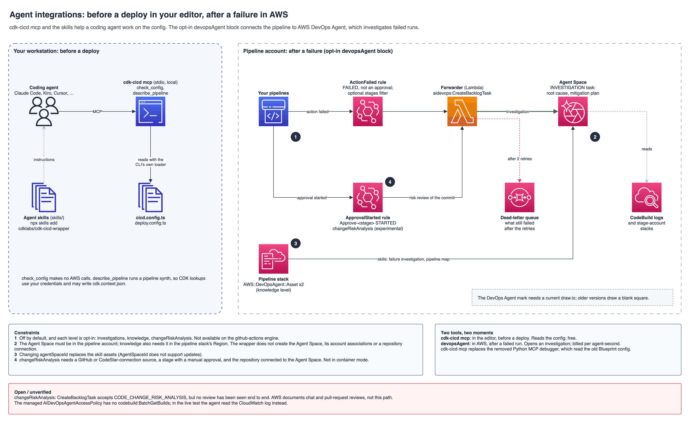
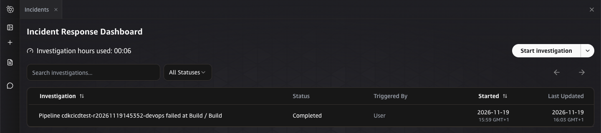
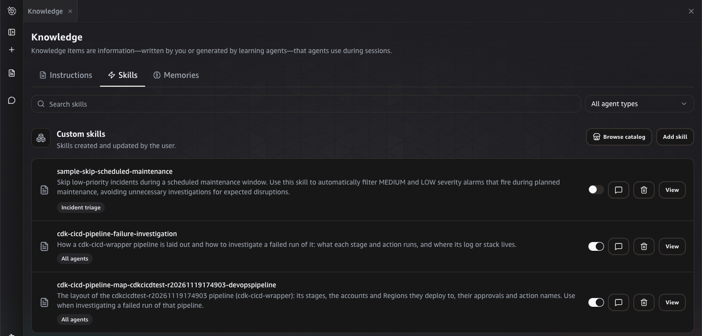
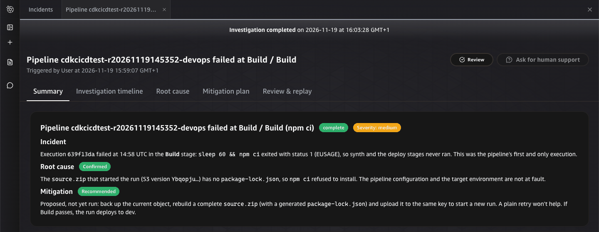
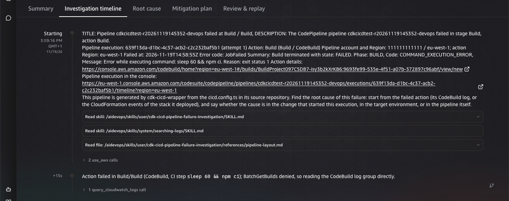
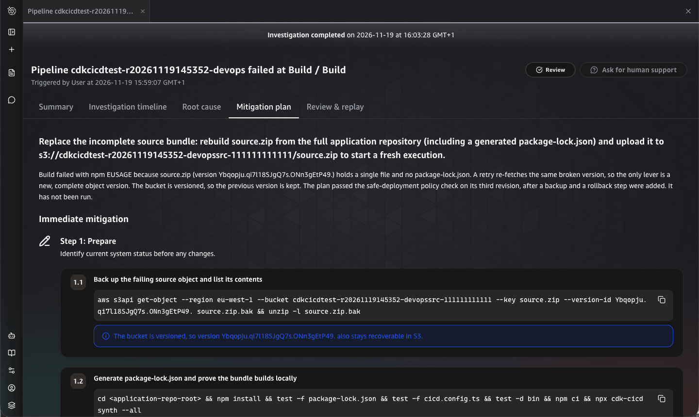

# AWS DevOps Agent

[AWS DevOps Agent](https://docs.aws.amazon.com/devopsagent/latest/userguide/about-aws-devops-agent.html)
investigates operational problems in your AWS accounts and reports a root cause and a mitigation plan.
DevOps Agent has no CodePipeline connector, so it does not see your pipeline on its own. `devopsAgent`
connects the two.

It is **off by default**, and inside it every capability is a separate **level** that is on only when its
block is present. Pick the ones you need:

| Level                | What you get                                                                                   | Status       |
| -------------------- | ---------------------------------------------------------------------------------------------- | ------------ |
| `investigations`     | Every failed pipeline action opens a DevOps Agent investigation (root cause, mitigation plan). | stable       |
| `knowledge`          | The pipeline publishes skills into the Agent Space, so investigations start in the right log or stack. | stable       |
| `changeRiskAnalysis` | When a gated stage waits for approval, DevOps Agent reviews the commit being promoted for release risks. | experimental |

```typescript
// cicd.config.ts
export default defineCICD({
  application: 'my-app',
  repository: Repository.codestarConnection(
    'my-org/my-app',
    'arn:aws:codestar-connections:eu-west-1:111111111111:connection/01234567-89ab-cdef-0123-456789abcdef',
  ),
  stages: ['dev', { name: 'prod', manualApproval: true }],
  devopsAgent: {
    agentSpaceId: 'a1b2c3d4-EXAMPLE',
    investigations: {},                                   // every failed action
    knowledge: {},                                        // both skills
    changeRiskAnalysis: { beforeApprovalOf: ['prod'] },   // experimental
  },
});
```

A `devopsAgent` block that enables no level is rejected rather than silently doing nothing. Removing a level
removes what it deployed on the next pipeline deploy.

This is not the [MCP server](../mcp/index.md). `cdk-cicd mcp` helps a coding agent in your editor check
`cicd.config.ts` before a deploy. `devopsAgent` works in AWS, after a pipeline action has failed. The diagram
shows both:



## What a level deploys

Everything goes into the pipeline stack, in the pipeline's account and Region.

**`investigations`**

- An EventBridge rule matching `CodePipeline Action Execution State Change` events in state `FAILED`, for this
  stack's pipelines only (the rule matches their ARNs), narrowed to the stages you choose. A rejected or
  timed-out manual approval also ends `FAILED`, but it is a decision, not an incident, so approvals are left out.
- A Lambda function that turns each matching event into one
  [`CreateBacklogTask`](https://docs.aws.amazon.com/devopsagent/latest/APIReference/API_CreateBacklogTask.html)
  call of type `INVESTIGATION`. The task names the pipeline, stage, action, execution ID and attempt, the
  action's error code and summary, and links to the action and the execution in the console.



*The investigation the forwarder opened for a failed Build action, in the Agent Space's operator web app.
The forwarder creates it through the `CreateBacklogTask` API, and the web app lists it as triggered by
"User".*

**`changeRiskAnalysis`**

- An EventBridge rule on the manual approval actions of the stages you name, in state `STARTED`.
- The same Lambda reads the commit the execution promotes (`codepipeline:GetPipelineExecution`) and requests a
  [Code Change Risk Analysis](https://docs.aws.amazon.com/devopsagent/latest/userguide/working-with-devops-agent-code-change-risk-analysis-index.html)
  of it (`CODE_CHANGE_RISK_ANALYSIS`). The review is a task in the Agent Space, with the commit and the stage in
  its title. Its report gives a recommended action (BLOCK, Deploy with Caution, or Standard Deployment), and the
  approver reads it there (operator web app) before approving. It informs the approval and does not hold it. The
  level is experimental: see Limits.

**Both of the above share** one function and one SQS dead-letter queue (SQS-managed encryption, TLS only,
14 days retention). The function has no inbound endpoint and signs its calls with its own IAM role. That role
may call `aidevops:CreateBacklogTask` on your one Agent Space and, with `changeRiskAnalysis`,
`codepipeline:GetPipelineExecution` on these pipelines. Beyond that it can only write its own logs (the Lambda
basic execution policy) and send to its dead-letter queue. There is no webhook and no shared secret.
EventBridge retries delivery, and the function retries a failing call twice more within six hours. What
still fails lands in the dead-letter queue, so a missed task is visible rather than lost. Each request
carries an idempotency token derived from the action execution, so a redelivered event asks for the same task
again.

**`knowledge`**

- Two skills, as `AWS::DevOpsAgent::Asset` resources owned by the pipeline stack:
    - `cdk-cicd-pipeline-failure-investigation`: what every stage and action of every engine runs, where its log
      or stack lives, and the usual causes of a failure. This is the skill from the repository's
      [`skills/`](../skills/index.md) directory.
    - `cdk-cicd-pipeline-map-<stack>`: generated from your config. It lists this pipeline's stages, their
      accounts, Regions and approvals, and the action names that deploy them.
- No function. Assets are updated in place when their content changes, and replaced if the Agent Space ID
  changes. CloudFormation creates them, so a custom CloudFormation execution role needs `aidevops:CreateAsset`,
  `aidevops:UpdateAsset` and `aidevops:DeleteAsset` on the Agent Space. CDK's default execution role has them.
- The pipeline map lists the stage accounts' IDs. Anyone with access to the Agent Space's operator web app can
  read them, the same people who can already read the investigations.
- In container mode, Repo 1 and Repo 2 each publish their own map (named after the stack). Turn
  `investigationSkill` on in only one of them, so the Agent Space holds a single copy of the generic skill.



*Both skills, published by the `knowledge` level of a test pipeline. The first entry is a sample skill the
Agent Space starts with.*

## Configuration

| Field                 | Type                          | Default               | Purpose                                                  |
| --------------------- | ----------------------------- | --------------------- | -------------------------------------------------------- |
| `agentSpaceId`        | `string`                      | — (required)          | The Agent Space (the ID, not the ARN).                   |
| `region`              | `string`                      | the pipeline's Region | The Agent Space's Region. `knowledge` needs it to be the pipeline's. |
| `investigations`      | `DevOpsAgentInvestigationsConfig` | off               | Open an investigation per failed action.                 |
| `knowledge`           | `DevOpsAgentKnowledgeConfig`  | off                   | Publish the skills.                                      |
| `changeRiskAnalysis`  | `DevOpsAgentChangeRiskAnalysisConfig` | off           | Review the commit before a gated stage's approval. Experimental. |

`investigations`:

| Field                    | Type                  | Default        | Purpose                                                                 |
| ------------------------ | --------------------- | -------------- | ----------------------------------------------------------------------- |
| `stages`                 | `string[]`            | every stage    | Investigate only these stages' failures, e.g. `['prod']`, to spend agent time where it matters. |
| `includePipelineActions` | `boolean`             | `true`         | Also investigate the pipeline's own actions: source, build/synth, self-update, asset publishing, Repo 2's plan, Repo 1's image build. |
| `priority`               | `DevOpsAgentPriority` | `HIGH`         | Priority of each investigation.                                         |

`knowledge`:

| Field                | Type      | Default | Purpose                                      |
| -------------------- | --------- | ------- | -------------------------------------------- |
| `investigationSkill` | `boolean` | `true`  | Publish the generic investigation skill.     |
| `pipelineMap`        | `boolean` | `true`  | Publish this pipeline's generated map.       |

`changeRiskAnalysis` (experimental):

| Field              | Type                  | Default        | Purpose                                                       |
| ------------------ | --------------------- | -------------- | ------------------------------------------------------------- |
| `beforeApprovalOf` | `string[]`            | — (required)   | Stages with a manual approval whose approval starts a review. |
| `priority`         | `DevOpsAgentPriority` | `MEDIUM`       | Priority of each review.                                      |

The levels are checked when the config loads, so a typo fails there instead of silently doing nothing. That
covers an unknown stage, an empty stage list, a filter Repo 1's image build cannot apply, a review before a
stage that has no approval, and a priority DevOps Agent does not know. Only `knowledge`'s Region check waits
until synth, when the pipeline's Region is known; for an environment-agnostic pipeline, CloudFormation makes
it at deploy time.

In container mode the same block goes into Repo 2's `deploy.config.ts`, where it covers the CD pipeline and every
target's auto-deploy pipeline (`stages` are target names). In Repo 1's `cicd.config.ts` it covers the image
build. `changeRiskAnalysis` is not available in container mode: Repo 1 only builds images, and Repo 2 promotes
an image, not a commit.

To deploy a change, push it: the `codepipeline` and `cdk-pipelines` engines run the whole pipeline, and their
self-update step applies it. A container-mode pipeline has no self-update stage, so run
`npx --no cdk-cicd deploy-ci` there. That also works for the other engines without a full run.

## Before you start

1. **Create an Agent Space in the pipeline account**, in a
   [Region DevOps Agent supports](https://docs.aws.amazon.com/devopsagent/latest/userguide/about-aws-devops-agent-supported-regions.html).
   Use the console, or CloudFormation (`AWS::DevOpsAgent::AgentSpace`; see
   [Getting started using CloudFormation](https://docs.aws.amazon.com/devopsagent/latest/userguide/getting-started-with-aws-devops-agent-getting-started-with-aws-devops-agent-using-aws-cloudformation.html),
   which also sets up the operator web app). Note its ID, which is the last segment of its ARN (`…:agentspace/<id>`).
2. **Associate the accounts it may investigate**: the pipeline account, where the CodeBuild logs and pipeline
   state live, and each stage account the pipeline deploys to, where the CloudFormation stacks live. See
   [Connecting multiple AWS accounts](https://docs.aws.amazon.com/devopsagent/latest/userguide/configuring-integrations-and-knowledge-connecting-multiple-aws-accounts.html).
   Without these associations an investigation runs but cannot read the evidence.
3. **For `changeRiskAnalysis`, connect the repository** (GitHub or GitLab) to the Agent Space. Code Change
   Risk Analysis reads the code through that integration, and indexing a new repository takes one to two hours.

The wrapper does not create the Agent Space, the account associations or the repository connection. All three
are long-lived and shared between pipelines, and who may use the operator web app is a decision for people.

## What an investigation finds

In a test of the `investigations` level, a commit without a `package-lock.json` broke the Build action
(`npm ci` failed). The investigation the forwarder opened completed in about four minutes, with no one
involved, and reported:

- **Symptom:** Build/Build failed in phase BUILD with `COMMAND_EXECUTION_ERROR`.
- **Finding:** the first real error in the CodeBuild log, `npm error code EUSAGE` (no lockfile).
- **Root cause:** the source bundle that started the run has no `package-lock.json`. The cause is in the
  change, not in the target environment or the pipeline configuration, and a retry will not help.
- **Mitigation plan:** back up the bad source, regenerate the lockfile and run `npm ci && npx cdk-cicd synth --all`
  locally, upload a complete bundle, verify the new run, with rollback steps. It proposes the plan; it does not
  run it.



The timeline shows where it started. It read the task the forwarder sent, then the
`cdk-cicd-pipeline-failure-investigation` skill and its pipeline-layout reference, before it went to the logs:



The mitigation plan is a sequence of steps with the commands to run, each with its own check and a rollback:



*Screenshots from a test run. Account IDs are replaced with 111111111111.*

It also listed what it could not see. AWS's managed `AIDevOpsAgentAccessPolicy` does not grant
`codebuild:BatchGetBuilds` or read access to the pipeline's S3 source, so the agent worked from the logs. With no
repository connected to the Agent Space, it could not read the application's code either. If you want those, add
them to the Agent Space's role yourself, scoped to the pipeline's build projects and source bucket, and connect the
repository.

## Cost

DevOps Agent bills by the agent-second ([pricing](https://aws.amazon.com/devops-agent/pricing/)). With
`investigations` on, every matching failed action opens one investigation, including failures you would have
recognised at a glance: use `stages` to limit it. The test above took about four minutes of agent time.
`changeRiskAnalysis` opens one review per approval of the stages you name. The Lambda, the rules and the skill
assets cost next to nothing.

## Limits

- **CodePipeline only.** `devopsAgent` is rejected with `engine: EngineType.GITHUB_ACTIONS`, which renders no
  CodePipeline. DevOps Agent's GitHub integration links deployments to its investigations, but does not open
  one per failed workflow run; see
  [Connecting to CI/CD pipelines](https://docs.aws.amazon.com/devopsagent/latest/userguide/configuring-integrations-and-knowledge-connecting-to-cicd-pipelines-index.html).
- **The Agent Space must be in the pipeline account**, and for `knowledge` also in the pipeline stack's Region.
- **Failed actions only.** A stopped or superseded execution is not a failure and opens nothing, and neither
  does a rejected or timed-out manual approval.
- **`changeRiskAnalysis` is experimental.** DevOps Agent's Code Change Risk Analysis is in preview. Requesting
  it from a pipeline uses the documented `CreateBacklogTask` API with task type `CODE_CHANGE_RISK_ANALYSIS`.
  AWS documents chat and pull-request reviews as its entry points. The review needs the repository connected to
  the Agent Space; without one, the task fails at once.
