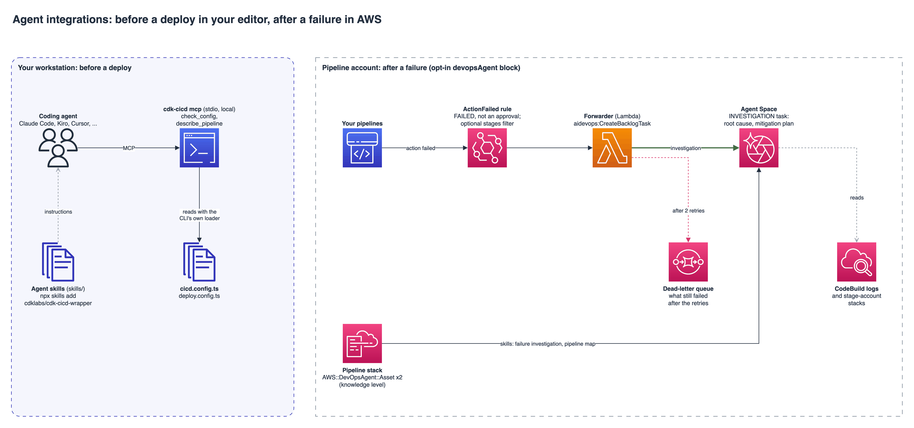

# MCP server

`cdk-cicd mcp` serves what the CLI knows about your project to a coding agent over the
[Model Context Protocol](https://modelcontextprotocol.io/) (MCP). It ships with the CLI, so there is nothing
extra to install, and it speaks MCP over stdio only: it never opens a network port.

It answers the questions only {{ project_name }} can answer: how your `cicd.config.ts` (or a container-mode
`deploy.config.ts`) resolves, and which pipeline it renders. It does not read live pipeline state. For that
(executions, CodeBuild logs, CloudFormation events) give your agent the
[AWS MCP Server](https://docs.aws.amazon.com/agent-toolkit/latest/userguide/getting-started-aws-mcp-server.html),
and for root-cause analysis of a failed run use [AWS DevOps Agent](../developer_guides/devops_agent.md). The
[agent skills](../skills/index.md) tell an agent how to combine them.



## Tools

| Tool                | What it does |
| ------------------- | ------------ |
| `check_config`      | Loads and validates `cicd.config.ts`/`.js` and `deploy.config.ts`/`.js` exactly as the CLI does, and summarizes them: source repository, stages with their accounts and Regions, approval gates, CI steps, deploy model, network, plugins and the DevOps Agent levels (`devopsAgent`). Each file is checked on its own; one that does not validate returns its error. No AWS calls. |
| `describe_pipeline` | Synthesizes the pipeline the way `cdk-cicd list-ci` does (no deploy) and lists each CodePipeline with its stages and actions, and what is connected to DevOps Agent (the forwarder, and the skills of the `knowledge` level). It runs your project's `cdk` npm script, so CDK context lookups (for example a VPC lookup) use the server's AWS credentials and may write `cdk.context.json`. Slow: a full `cdk synth`. A client that cancels the call stops the synth. |

Both take an optional `directory` argument (the project directory holding `cdk.json`). It defaults to the
directory the server was started in and cannot point outside it, so a model cannot aim the tools at some
other checkout. Both tools run your project's own code, exactly as the CLI does: the config file, and for
`describe_pipeline` the CDK app. Their MCP annotations say so: `check_config` is read-only and closed-world,
`describe_pipeline` is neither. The config summaries carry no secret values; a config holds only references
such as secret ARNs.

## Setup

Install the CLI in the project as usual (`npm i -D @cdklabs/cdk-cicd-wrapper-cli`), then register the server
in your MCP client. Most clients take this shape:

```json
{
  "mcpServers": {
    "cdk-cicd": {
      "command": "npx",
      "args": ["--no", "cdk-cicd", "mcp"]
    }
  }
}
```

The client starts the server as a child process, and the server works on the directory it starts in. Make
that the project directory: register the server in the project's own MCP config, or set your client's
working-directory option for it. `--no` stops `npx` from downloading a registry package when the CLI is not
installed where the server starts; an unrelated public package named `cdk-cicd` exists. The server writes
the protocol to stdout and everything else (logs, output of your config file) to stderr, where clients show
it as server logs.

## Upgrading from the Python debugger server

Earlier releases documented a Python server under `mcp-servers/debugger-mcp` with six `check_*` tools. It
read the Blueprint (0.x) configuration surface (`ACCOUNT_RES`-style environment variables, `package.json`
settings, `PipelineBlueprint` calls), so it reported a valid Autopilot project as misconfigured, and against
current releases of its MCP dependency five of its six tools failed at import. It was never published to a
package registry. `cdk-cicd mcp` replaces it:

| Python tool                                                        | Now |
| ------------------------------------------------------------------ | --- |
| `check_comprehensive_config`, `check_stage_definitions`, `check_git_provider`, `check_ci_configuration`, `check_vpc_configuration` | `check_config`, which runs the same validation as `defineCICD` and the CLI |
| `check_plugins`                                                    | `check_config` lists the configured plugins; `cdk-cicd security-scan` scans the code |
| (none)                                                             | `describe_pipeline` |
