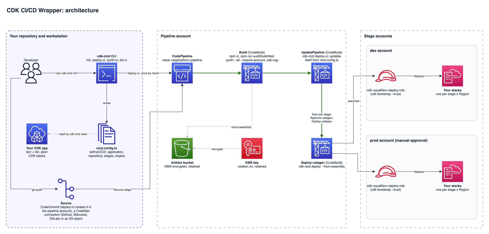
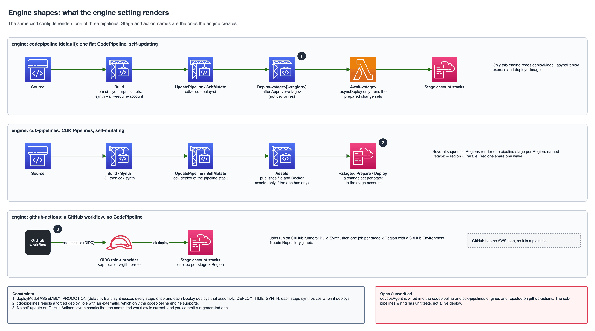
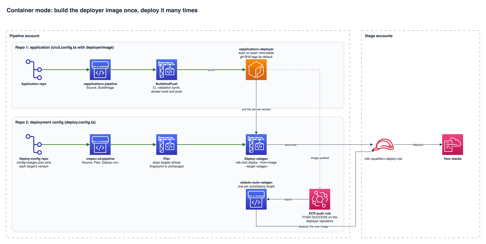
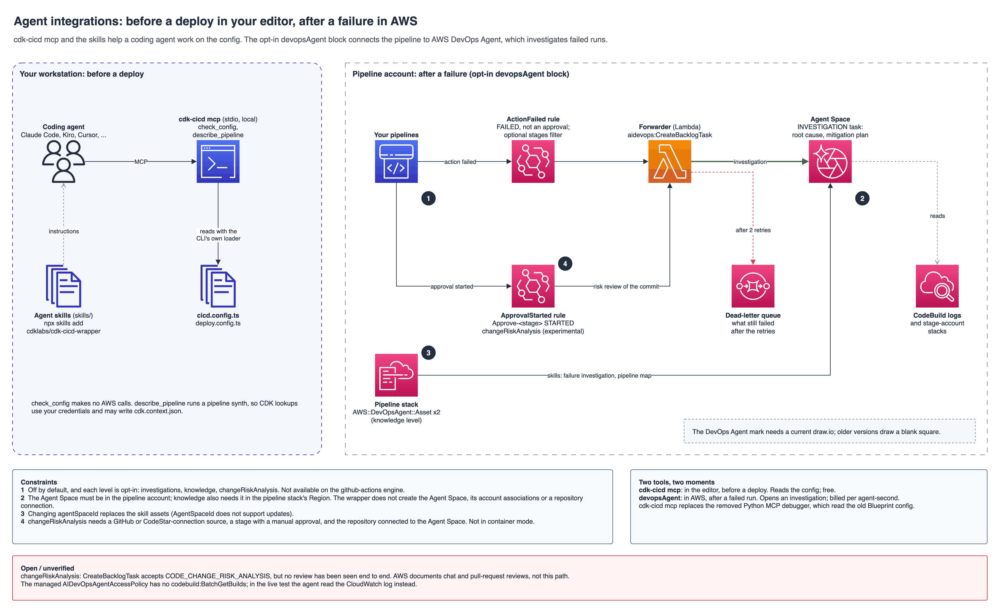

# {{ project_name }}

## Introduction

The {{ project_name }} is a comprehensive CI/CD platform for AWS CDK-based applications and solutions. It is config-driven and zero-touch: you describe your pipeline in one `cicd.config.ts` file, and the `cdk-cicd` CLI wraps it around your **unmodified** CDK app. It provides a standardized and easy-to-use Continuous Integration solution leveraging AWS CodeBuild — the process ensures that the codebase follows code style guidelines, can be successfully compiled, runs supplied tests, and performs various quality checks related to security.

Once the codebase successfully passes the quality gates, the {{ project_name }} enables Continuous Deployment of the solution across the stages you define — for example `dev`, `int`, and `prod` — gating every stage that isn't an inner-loop stage behind a manual approval by default.

## Why use the {{ project_name }}?

Setting up CI/CD pipelines for AWS CDK-based projects is a recurring and time-consuming activity for many teams. This process often results in different "flavors" of pipelines, leading to duplicated effort and increased maintenance and governance complexity.

The CI/CD process setup is often thought of as a one-time activity, but in reality, it is a continuous process that needs to be done systematically.

The {{ project_name }} can address these issues and drastically reduce the effort needed to maintain and develop AWS CDK-based solutions, allowing you to focus on your solution while it takes care of the CI/CD process.

Here are some key features provided by the {{ project_name }}:

- :white_check_mark: **Zero wrapper code in your app** (TypeScript/JavaScript apps) — your `bin/` stays exactly what `cdk init` produced; the pipeline lives in a separate `cicd.config.ts`. Non-Node apps (e.g. Python) use the explicit `CdkCicd.attach(app)` opt-in instead — see [Getting Started](../getting_started/index.md)
- :white_check_mark: [Customizable CI](../developer_guides/ci.md) steps that default to your project's own npm scripts (`npm run audit`/`build`/`test`)
- :white_check_mark: Integration of various [security scanning tools](../developer_guides/security.md) (cdk-nag, Bandit, Semgrep, ShellCheck, dependency-vulnerability scanning)
- :white_check_mark: Multi-staged Continuous Deployment process with manual-approval gating on by default for anything past your inner development loop
- :white_check_mark: Flexible definition of stages, including multi-region stages and per-stage AWS accounts
- :white_check_mark: A choice of pipeline engines — a lightweight [CodePipeline](https://docs.aws.amazon.com/cdk/api/v2/docs/aws-cdk-lib.aws_codepipeline-readme.html) by default, a [CDK Pipelines](https://docs.aws.amazon.com/cdk/api/v2/docs/aws-cdk-lib.pipelines-readme.html)-based engine, or a GitHub Actions engine that renders a workflow file instead of an AWS-hosted pipeline
- :white_check_mark: Automated Open Source License checking (with a provided list of licenses that should not be present in your PRODUCTION workloads)
- :white_check_mark: Optional centralized compliance/access-log bucket, VPC, and HTTP proxy support for every CodeBuild project the pipeline creates
- :white_check_mark: Dependency vulnerability scanning in the CI/CD for Node.js and Python dependencies (in case of CVE findings, block the pipeline)

- :white_check_mark: Help for AI agents: an MCP server for coding agents (`cdk-cicd mcp`), agent skills, and an opt-in [AWS DevOps Agent](../developer_guides/devops_agent.md) integration that investigates failed runs

Most of these features can be used independently of the CDK constructs, directly through the {{ project_name }} CLI.

## Architecture

Three places, three kinds of thing:

- **Your repository and workstation.** Your CDK app stays unmodified. `npx cdk-cicd init` writes
  `cicd.config.ts` and points `cdk.json` at `cdk-cicd exec`, which runs the app with the wrapper's hooks.
  `npx cdk-cicd deploy-ci`, run once by hand, provisions the pipeline.
- **The pipeline account.** The pipeline stack (`<application>-pipeline`) holds the CodePipeline, its
  CodeBuild projects, and an artifact bucket encrypted with a KMS key. Both are kept when the stack is
  deleted, unless you pass `deploy-ci --disposable`. The opt-in build environment lives here too: VPC and
  proxy, CodeArtifact or a private npm registry, and the compliance access-log bucket.
- **The stage accounts.** Each `Deploy-<stage>` action assumes the stage account's CDK bootstrap role
  (`cdk-<qualifier>-deploy-role`), so every stage account is bootstrapped with
  `cdk bootstrap --trust <pipeline account>` and the same qualifier.

The numbered callouts on the diagram mark the settings that cannot be changed in place, such as the
`application` name, which names the pipeline stack (and derives the qualifier when `qualifier` is unset). Its
open/unverified panel lists what has not been proven on a live deploy yet.

## CI/CD process

1. Changes are committed to the Git repository in a branch, and a pull request is opened for the tracked
   branch (`main` by default).
2. The pull request is reviewed, approved and merged.
3. The merge starts the pipeline. With the default engine:
    - **Build**: your `ci.steps`, or by default `npm ci` then your project's own npm scripts
      (`npm run audit`/`build`/`test`, each run only if present). Then the synth with CDK Nag:
      `cdk-cicd synth --all --require-account` (with `DEPLOY_TIME_SYNTH`, `synth --stage` for validation only).
      A stack that binds no account fails here.
    - **UpdatePipeline**: the pipeline updates its own definition from the latest `cicd.config.ts`. The
      `codepipeline` and `cdk-pipelines` engines do this. GitHub Actions and container-mode pipelines do not:
      see below.
    - **One stage per configured stage**, in order: a manual approval for every stage other than `dev` and
      `res` (unless you set `manualApproval`), then the deploy into that stage's account and Regions.

## Engine shapes

The same `cicd.config.ts` is rendered by the engine you select (`engine`): a flat CodePipeline (the default),
a self-mutating CDK Pipelines pipeline, or a GitHub Actions workflow. The settings that shape the deploy
step itself apply to the default engine only:

- `deployModel`: synthesize every stage once and promote that assembly (the default), or synthesize each
  stage when it deploys.
- `asyncDeploy`: deploy through change sets that a Lambda action executes.
- `express`: deploy without waiting for resource stabilization (rollback disabled; not for production).
- `deployerImage`: container mode.

## Container mode

With the default CodePipeline engine you can split build from deploy. A CI repository builds a
config-agnostic deployer image into ECR, and a config-only CD repository (or the local
`cdk-cicd deploy --from-image` executor) runs that image against as many targets as you like. Neither
pipeline updates itself: after changing `cicd.config.ts` or `deploy.config.ts`, run `npx cdk-cicd deploy-ci`
again. See the [Container mode guide](../developer_guides/container_mode.md).

## Agent integrations

Two separate tools, for two different moments:

- **Before a deploy, in your editor**: `cdk-cicd mcp` is an MCP server (stdio) in the CLI. Its
  `check_config` tool validates and summarizes `cicd.config.ts`/`deploy.config.ts`, and its
  `describe_pipeline` tool lists the stages and actions they render. See the [MCP server guide](../mcp/index.md).
  It replaces the Python MCP debugger this repository used to ship, which read the `0.x` config.
- **After a failure, in AWS**: the opt-in `devopsAgent` block connects the pipeline to AWS DevOps Agent. The
  `investigations` level opens a DevOps Agent investigation for each failed action. The `knowledge` level
  publishes skills into the Agent Space. The experimental `changeRiskAnalysis` level reviews the commit
  before a gated stage. See [AWS DevOps Agent](../developer_guides/devops_agent.md).

The [agent skills](../skills/index.md) work with both.

All four diagrams are pages of one draw.io file, `docs/content/assets/diagrams/autopilot-diagrams-source.drawio`.
Change the source and re-export the PNGs in the same change as the behaviour they show.

You can read more about these elements in the [Developer Guide](../developer_guides/index.md).

## Getting Started

If you are eager to start using the {{ project_name }}, check out the [Getting Started](../getting_started/index.md) guides.

## Contributing to the {{ project_name }}

The team encourages you to contribute to make it an even better framework. For details, see [contributing](../contributing/index.md).
