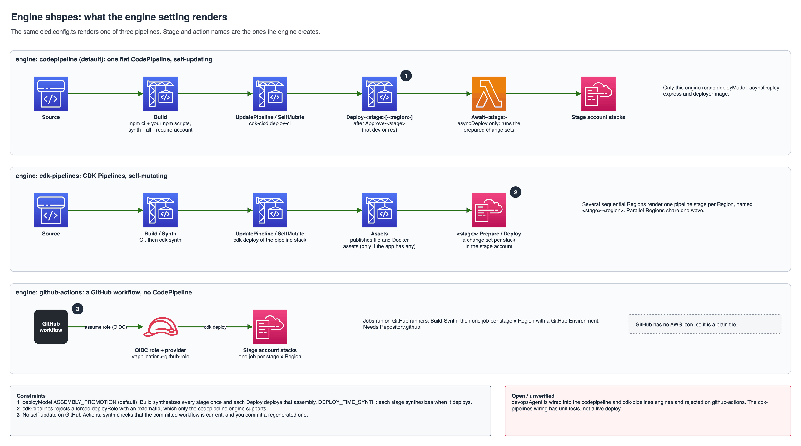

# A config-driven pipeline (Autopilot)

!!! abstract "What you'll build"
    - A working CodePipeline for a stock CDK app, provisioned from a single `cicd.config.ts`.
    - An understanding of **every** `defineCICD` field and when to reach for it.
    - A customized CI phase — your own named build steps and, optionally, a custom build image.

The whole Autopilot opt-in is two things: a `cicd.config.ts`, and pointing `cdk.json` at `cdk-cicd exec`.

## 1. Your app stays plain CDK

`bin/app.ts` is what `cdk init` gave you — a plain `App` with your stacks. No `PipelineBlueprint`,
no builder. Two things change. First, uncomment the `env` line that `cdk init` ships commented
out, so each stack names its account. The wrapper deploys only such stacks: the pipeline's Build stage fails
on one that does not, and a local `cdk-cicd synth` warns about it. Second, give the stack a name per stage
with the `stageStackName` helper. The `dev` and `prod` stages below name no `env`, so both deploy into the
pipeline's account and Region, and two stages that deploy the same stack name into one account and Region
share one stack: `prod` would update `dev`'s. Stages in different accounts or Regions do not need it.

```ts
// bin/app.ts
import * as cdk from 'aws-cdk-lib';
import { stageStackName } from '@cdklabs/cdk-cicd-wrapper';
import { MyStack } from '../lib/my-stack';

const app = new cdk.App();
new MyStack(app, 'my-app', {
  env: { account: process.env.CDK_DEFAULT_ACCOUNT, region: process.env.CDK_DEFAULT_REGION },
  stackName: stageStackName('my-app'), // my-app-dev, my-app-prod
});
```

## 2. Describe the pipeline in `cicd.config.ts`

```ts
// cicd.config.ts
import { defineCICD, Repository } from '@cdklabs/cdk-cicd-wrapper';

export default defineCICD({
  application: 'my-app',
  qualifier: 'hnb659fds', // the qualifier a plain cdk bootstrap creates
  repository: Repository.codecommit('my-app'), // or .s3('bucket/app.zip')
  stages: ['dev', 'prod'],
});
```

## 3. Point `cdk.json` at the wrapper's exec hook

```json
{
  "app": "npx cdk-cicd exec bin/app.ts"
}
```

`cdk-cicd exec` runs your app under a preload that injects the resolved config (and tags, synthesizer, and
compliance Aspects) around it — which is how your plain `bin/` becomes wrapper-aware without a builder
chain. The `stageStackName` import only names the stack.

!!! tip "Let `cdk-cicd init` write steps 2 and 3"
    `npx cdk-cicd init --stages dev,prod` writes `cicd.config.ts` and points `cdk.json` at
    `cdk-cicd exec`, reading your entry from the existing `app` command. It refuses to overwrite an
    existing config, warns about a commented-out `env` line (it does not edit your `bin/`), and prints
    the remaining commands, including the CodeCommit commit and push. Preview with `--dry-run`. Use `--source codestar` or `--source s3` for the other
    sources.

## 4. Provision the pipeline — once

```bash
npx cdk-cicd deploy-ci
```

This deploys **one** pipeline into your hub account from `cicd.config.ts` alone. With
`Repository.codecommit('my-app')` (no `existing: true`), it also creates the CodeCommit repository, and
that repository starts empty: the run CodePipeline starts on creation fails at Source. Push your app to start the real one. These are the
commands `cdk-cicd init` prints (replace `<region>` with the pipeline's Region):

```bash
git remote add origin https://git-codecommit.<region>.amazonaws.com/v1/repos/my-app
git config credential.https://git-codecommit.<region>.amazonaws.com.helper ''
git config --add credential.https://git-codecommit.<region>.amazonaws.com.helper '!aws codecommit credential-helper $@'
git config credential.https://git-codecommit.<region>.amazonaws.com.UseHttpPath true
git add -A && git commit -m 'Deliver the app through cdk-cicd-wrapper'
git push -u origin HEAD:main   # starts the first pipeline run
```

On every run the pipeline does:

```
Source → Build (checks + synth) → UpdatePipeline (re-deploys itself from config) → deploy dev → deploy prod
```



*The top row, `engine: codepipeline`, is this flat pipeline; the other two rows are the alternate engines.*

The **UpdatePipeline** stage means you never run `deploy-ci` again by hand: change `cicd.config.ts`, push,
and the pipeline re-synthesizes its own definition on the next run and applies the change before the
stages it affects.

## Every field of `defineCICD`

The two-stage example above uses three fields. Here is the full set, and **why each matters** — you'll
only ever write the few you need, because the wrapper resolves sensible defaults for the rest.

| Field | What it does | Why it matters |
|---|---|---|
| `application` | Logical name for the app and its resources. Without it the pipeline stack is named `cdk-cicd-pipeline` (unless `pipelineStackName` overrides it); only `cdk-cicd init` reads `package.json#name`, to fill this field in. | The prefix on the pipeline stack name (`<application>-pipeline`) — set it once so resources are recognizable. |
| `qualifier` | Short (≤10 char) sanitized bootstrap id. Derived from `application` when unset; both synthesizers honor an explicit value. | Set `'hnb659fds'` to deploy into accounts a plain `cdk bootstrap` prepared. Left unset, the derived value needs `cdk bootstrap --qualifier <it>` in every target account and Region. |
| `repository` | The pipeline's source: `Repository.codestarConnection('org/repo', connectionArn, branch?)` for GitHub with the AWS-hosted engines, `Repository.codecommit(...)`, or `Repository.s3(...)`. `Repository.github(...)` is reserved for `GITHUB_ACTIONS`. | This is *where* the pipeline reads code and *what* triggers it — the one field you almost always set explicitly. |
| `stages` | Ordered list of deployment stages — bare names or objects with `env`, `manualApproval`, `deployment`. | Your promotion path (dev → prod). Config-as-data, not pipeline code. Covered in the next chapter. |
| `ci` | Customizes the CI phase: `steps`, `synthStages`, `image`. | Add your own build/test steps or a custom image. See [Customizing CI](#customizing-ci) below. |
| `codeArtifact` | Authenticates builds to a private CodeArtifact repo (`domain`, `repository`, `account?`, `region?`, `npmScope?`). | Needed when your deps live in a private registry. See chapter 4. |
| `deployModel` | `DeployModel.ASSEMBLY_PROMOTION` (default) or `DeployModel.DEPLOY_TIME_SYNTH`. | Controls when synth happens — one synth per run vs per-stage at deploy time. See chapter 3. |
| `asyncDeploy` | `boolean` (default `false`). Hands the CloudFormation wait to a Lambda instead of holding a build. | Saves build compute when the CloudFormation wait dominates. See chapter 3. |
| `synthesizer` | `{ type?: SynthesizerType.DEFAULT \| SynthesizerType.APP_STAGING, appId?: string }`. | `DEFAULT` suits generated pipelines. `APP_STAGING` is limited to direct/local deployment and Repo 1 image-only builds; every generated deployment pipeline rejects it. |
| `engine` | Selects the CD engine (`EngineType`). | `EngineType.CODEPIPELINE` is the default and covers most cases — you rarely set it. Two alternates exist: `CDK_PIPELINES` (plain CDK Pipelines, no CodePipeline-specific extras) and `GITHUB_ACTIONS` (renders a `.github/workflows/deploy.yml` instead of an AWS-hosted pipeline — see [GitHub as source & CD engine](../../developer_guides/vcs_github.md)). Tuning for the default engine lives on the stages and `ci` (chapter 3), not here. |
| `githubActions` | GitHub Actions engine config (`roleName`, `subjectClaims`, `workflowTriggers`, etc.). | Only read when `engine` is `EngineType.GITHUB_ACTIONS`. |
| `deployerImage` | Turns the pipeline into a config-agnostic image builder (`BuildImage.docker({...})`). | The container-mode entry point. See chapter 5. |

!!! tip "Start small"
    The minimum config is `repository` + `stages`. Without `application` the pipeline stack is named
    `cdk-cicd-pipeline`, the engine defaults to CodePipeline, and the synthesizer defaults to
    `DefaultStackSynthesizer`. Add fields only when a default doesn't fit.

!!! warning "`APP_STAGING` is not a generated-pipeline synthesizer"
    The installed alpha supports a custom bootstrap qualifier for direct/local `cdk deploy`, and Repo 1
    may bake that configuration into a deployer image. Flat CodePipeline, Repo 2, CDK Pipelines, and
    GitHub Actions deployment pipelines reject it. On the direct/local path, custom `deployRole` and
    `cfnExecutionRole` values become the application stack's deployment identities. The separate
    staging support stack uses caller/base credentials, and a deploy-role ExternalId is unsupported.

## Customizing CI

The `ci` block shapes the Build phase. All three sub-fields are optional; with none set, the build runs
your project's own npm scripts (`npm run audit`/`build`/`test`, each run-if-present, warn-if-absent)
plus the synth step.

**Named build steps (`ci.steps`)** — a map of `{ name: shell-command }`. The commands run in the Build
phase in the order you list them, so you add project-specific gates without editing pipeline code. They
**replace** the whole default CI, `npm ci` included, so make `install: 'npm ci'` the first step. The
synth step is still appended after them:

```ts
import { defineCICD, Repository } from '@cdklabs/cdk-cicd-wrapper';

export default defineCICD({
  application: 'my-app',
  qualifier: 'hnb659fds', // the qualifier a plain cdk bootstrap creates
  repository: Repository.codestarConnection(
    'my-org/my-app',
    'arn:aws:codestar-connections:eu-west-1:111111111111:connection/01234567-89ab-cdef-0123-456789abcdef',
  ),
  stages: ['dev', 'prod'],
  ci: {
    steps: {
      install: 'npm ci', // ci.steps replace the default CI, npm ci included
      lint: 'npm run lint',
      test: 'npm test',
      audit: 'npx cdk-cicd check-dependencies',
    },
  },
});
```

**A custom build image (`ci.image`)** — point CI at your own CodeBuild image (a registry reference) when
you need tools the default image doesn't ship:

```ts
  ci: {
    image: 'public.ecr.aws/my-org/ci-node:20',   // custom CodeBuild image for CI steps
    steps: { install: 'npm ci', test: 'npm test' },
  },
```

For an AWS-hosted engine, a private ECR `ci.image` must be in the pipeline account and the same Region
as its CodeBuild project. Public ECR references such as `public.ecr.aws/...` are not subject to the
private-repository pull contract. For an authenticated Docker Hub, GHCR, or custom registry image,
add `ci.codeBuildImageCredentials` with the complete ARN of a Secrets Manager secret containing
`username` and `password` (and `encryptionKeyArn` for a customer-managed KMS key). GitHub Actions uses
GitHub secret names under `githubActions.buildContainerCredentials` instead; it rejects CodeBuild image
IDs and private ECR job containers because those credentials cannot be established before the pull.

**Synth scope (`ci.synthStages`)** — only with `deployModel: DeployModel.DEPLOY_TIME_SYNTH`: `'all'`
synthesizes every stage as a validation gate; a list narrows it to specific stages when synth cost
matters. Under the default `ASSEMBLY_PROMOTION` the Build already synthesizes every stage, and setting
`ci.synthStages` at all, `'all'` included, makes rendering the pipeline (`deploy-ci`) fail. Chapter 3
covers the deploy models.

!!! info "The build image needs the AWS CLI"
    Steps like the CodeArtifact login and asset publishing shell out to the AWS CLI, which the default
    CodeBuild image ships. If you set a custom `ci.image`, make sure the AWS CLI is on its `PATH`.

## Verify

!!! success "Verify"
    Confirm the pipeline exists and runs end to end:

    - In the **CodePipeline** console, your pipeline shows the flat
      `Source → Build → UpdatePipeline → dev → prod` shape.
    - The execution your push started deploys `dev`, then waits at `Approve-prod`: stages other than
      `dev` and `res` are gated by default (chapter 2). Approve it and the execution reaches **Succeeded**.
    - Compare the CodeBuild project count to a Blueprint pipeline: Autopilot provisions one `Deploy-<stage>`
      project per stage plus the `Build` and `UpdatePipeline` projects — four here, not one per asset.

    You can also validate the config locally before pushing:

    ```bash
    npx cdk-cicd synth --all       # synthesizes every stage from your config
    ```

## Recap

You turned a stock CDK app into one flat CodePipeline with a single config file and a one-line `cdk.json`
change — and in `bin/` only an `env` line and a per-stage stack name. You know every `defineCICD` field,
and you can add your own CI steps and image. The next chapters go deep on the fields you'll reach for most: stages and approvals, deploy
models and tuning, private registries, and container mode.
